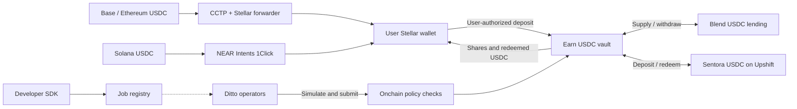

# Soroban Automation and Earn

**One USDC vault on Stellar, automated allocation across approved strategies, and deposits from supported external networks.**

Ditto brings its operator network and a public job SDK to Stellar. Earn is the first application. The SCF Open Track request is **$96,000 over 16 weeks**, covering 1,200 team-hours at $80/hour.

**Current implementation:** a [minimal native-XLM custody proof](prototype/README.md) is deployed on Stellar testnet, with six unit tests and deposit/withdrawal transaction evidence. It is self-funded and excluded from the grant budget. The full USDC vault, adapters, registry, SDK and funding routes below are the funded build, not existing deployments. [Prior work](docs/evidence.md) covers Mezo/Spark and the EVM operator network.

## Deliverables

- **Operators and SDK:** create, cancel and monitor supported allocation jobs. Two separately keyed executors provide failover. A second compatible testnet vault demonstrates reuse without operator-code changes.
- **Earn:** USDC deposits, shares, valuation and redemptions, with Blend and Sentora/Upshift adapters. Allocate for expected net return after costs within exposure and liquidity limits.
- **External deposits:** Base/Ethereum USDC through CCTP and Solana USDC through NEAR Intents. Settlement reaches the user's Stellar account before a separate authorized vault deposit. Native wallet connections support Freighter and xBull.

Users own Earn shares. Contracts hold idle USDC and strategy positions. Ditto operators cannot redirect withdrawals. Sentora's managed underlying backing has its own custody, valuation and liquidity risks and can be deployed outside Stellar. The app reports this exposure and available redemption liquidity.

Launch uses a 100,000 USDC deposit cap, a 10% idle target and a 20% cap on new/increased Sentora exposure. Mainnet deposits open after independent review and critical/high remediation. Existing EVM restaking does not automatically extend slashing guarantees to Stellar jobs.

## Reviewer documents

| Document | Contents |
| --- | --- |
| [Architecture](docs/architecture.md) | Funding, custody, valuation, contracts and operator controls |
| [Two-page visual PDF](docs/technical-architecture.pdf) | Deposit and automation diagrams |
| [Roadmap and budget](docs/roadmap.md) | Three milestones, task hours and four SCF payments |
| [Budget CSV](docs/budget-hours.csv) | 1,200 hours / $96,000, costed by task |
| [Security design](docs/security.md) | Initial threat model and monitoring design |
| [Acceptance test plan](docs/test-plan.md) | Accounting, routing, strategy and execution tests |
| [Deployment status](docs/deployments.md) | Current proof and required release manifest |
| [Prior work](docs/evidence.md) | Mezo/Spark and EVM operator evidence |

Vlad Shad and Efim Zhitomirskiy are the hands-on engineers for Soroban implementation and operator integration. Additional Stellar strategies, eligible RWA integrations and future Spark yield access are extensions outside this build.

New Ditto-authored repository material is released under [Apache-2.0](LICENSE), except Ditto branding, for which no trademark rights are granted. Referenced third-party projects retain their own licenses. AI assisted the documents, prototype source and tests. Named-engineer code review and independent audit are not claimed for the prototype. The full implementation and external review remain delivery steps.
