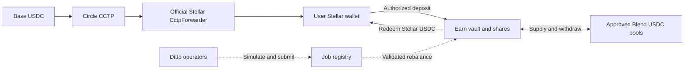

# Soroban Automation and Earn

**Deposit USDC on Stellar, automate allocation, redeem to your wallet.**

Ditto is building reusable operator infrastructure and a vault platform on Stellar. Earn is the first application: a USDC vault whose operators rebalance approved positions to improve expected net yield within onchain risk and liquidity limits.

**Build status:** design and documentation. This repository contains the architecture and delivery specification for Ditto's SCF Open Track application. It does not yet contain a runnable Soroban implementation, deployed Stellar contracts or audit results. Existing Mezo and EVM products are [prior work](docs/evidence.md).

## What the build delivers

- **Operators and public SDK:** create, cancel and inspect supported automation jobs; reuse the execution layer across compatible Soroban vaults.
- **Earn:** USDC deposits, proportional shares, pool accounting, allocation and redemptions. Blend is the launch integration; two testnet pools demonstrate rebalancing.
- **EVM onboarding:** Base USDC reaches the user's Stellar wallet through CCTP, followed by a separate authorized vault deposit. Strategy capital remains on Stellar.

Operators submit transactions; vault and pool contracts hold the funds. Execution permissions, pool allowlists, caps, cooldowns and nonces are enforced onchain. A capped mainnet launch follows independent review and resolution of critical/high findings.

## Review the design

| Document | Contents |
| --- | --- |
| [Architecture](docs/architecture.md) | Asset flow, custody, contract boundaries and operator execution |
| [Two-page architecture PDF](docs/technical-architecture.pdf) | Visual overview for application reviewers |
| [Roadmap and budget](docs/roadmap.md) | Four months, $120,000, three milestones and SCF payment schedule |
| [Security design](docs/security.md) | Initial STRIDE analysis and monitoring design |
| [Acceptance test plan](docs/test-plan.md) | Planned invariants, integration tests and launch evidence |
| [Deployment status](docs/deployments.md) | Current status and evidence required before release |
| [Prior work](docs/evidence.md) | Mezo/Spark product and existing EVM operator infrastructure |

## Scope and team

Launch focuses on approved Blend USDC pools and an idle withdrawal buffer, without leverage. If only one mainnet pool qualifies, Earn provides automated position management and onboarding; it does not promise an advantage over that pool's direct lending rate. Additional Stellar lending and eligible RWA adapters are future extensions, outside this build.

Vlad Shad and Efim Zhitomirskiy are the hands-on engineers for Soroban implementation and operator integration. [Ditto Network](https://dittonetwork.io) builds the existing operator network and Mezo/Spark vault.

New Ditto-authored repository material is released under [Apache-2.0](LICENSE), except Ditto branding, for which no trademark rights are granted. Referenced third-party projects retain their own licenses. AI assisted preparation of these design documents; implementation, testing and external review remain explicit delivery steps.
