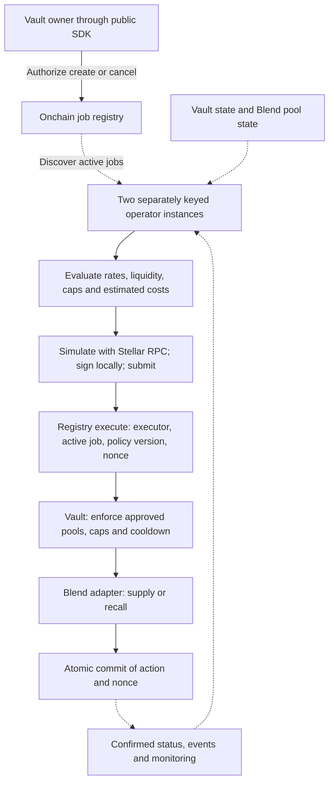

# Architecture

Earn is a USDC vault on Stellar, operated through a reusable job registry and Ditto execution connector. This document specifies the build; interfaces are design-level and will be finalized with implementation and review.

## Assets and custody

| Component | Responsibility | Holds user assets? |
| --- | --- | --- |
| User wallet | Authorizes deposits and redemptions | USDC before deposit and after redemption; vault shares |
| Earn vault | Share accounting, idle buffer, approved allocation | Idle Stellar USDC and ownership of pool positions |
| Blend pools | Lending reserves and indexed positions | Supplied USDC |
| Job registry | Owner authorization, job policy, executor checks, nonce | No |
| Operators | Read state, evaluate policy, simulate, sign and submit | No |
| CCTP / official forwarder | Burn-and-mint settlement into Stellar | Transient mint-and-forward; no Ditto custodial wallet |

The asset is Circle-issued USDC through its Stellar Asset Contract. All funded yield positions remain on Stellar. Shares represent a proportional claim on idle USDC plus the underlying value of indexed pool positions. Accounting must handle integer rounding, first deposits, donations and insufficient pool liquidity.

## Deposit to redemption

```mermaid
sequenceDiagram
    actor U as User
    participant C as Circle CCTP
    participant F as Stellar CctpForwarder
    participant W as User Stellar wallet
    participant V as Earn vault
    participant P as Approved Blend pools
    opt Fund from Base
        U->>C: Sign USDC burn with Stellar destination
        C-->>U: Attestation available
        U->>F: Submit attested message
        F->>W: Mint and forward USDC atomically
    end
    U->>V: Authorize deposit from Stellar wallet
    W->>V: Transfer USDC
    V->>U: Record vault shares
    Note over V,P: Allocation through an authorized registry execution
    V->>P: Supply USDC; vault owns position
    U->>V: Authorize redemption
    V->>P: Recall liquidity if buffer is insufficient
    P->>V: Return available USDC
    V->>W: Pay redemption and burn shares atomically
    Note over U,P: Insufficient liquidity reverts the entire redemption; shares remain intact
```

Native deposits start at the Stellar wallet. Base funding and the vault deposit are separate transactions; cancelling the deposit leaves the received USDC in the user's wallet. The app tracks burn, attestation, mint and deposit independently, and resumes from confirmed steps.

CCTP integration follows the [official Stellar guide](https://developers.circle.com/cctp/references/stellar): use the official forwarder for both `mintRecipient` and `destinationCaller`, encode the user's Stellar recipient in hook data, validate recipient readiness, and handle six-decimal CCTP amounts versus seven-decimal Stellar USDC. Pin verified network-specific addresses before release. An interrupted session must not trigger a second deposit.

## Automation network



The first valid execution of a job nonce succeeds; duplicate attempts revert. Job cancellation takes effect when confirmed and prevents subsequent execution, without reversing completed transactions. Simulation is a preflight check; current onchain authorization and policy checks remain decisive.

Operators evaluate expected returns after costs and rebalance only above the configured benefit threshold. They cannot change vault policy or redirect withdrawals. Two separately keyed instances provide failover, not proof of independent organizational control. Existing EVM restaking does not automatically provide slashable security for Stellar jobs.

## Contract and SDK boundaries

| Surface | Planned operations / state |
| --- | --- |
| Vault | `deposit(owner, assets, min_shares)`, `redeem(owner, shares, min_assets)`, registry-only `rebalance(targets)` |
| Registry | Job owner, compatible vault, active flag, policy version, next execution nonce; executor authorization |
| Public TypeScript SDK | `createJob`, `cancelJob`, `getJobStatus`; transaction building and confirmation tracking |
| Operator connector | Job discovery, state reads, simulation, local signing, submission, confirmation and safe retry |
| Blend adapter | Allowlisted supply/withdrawal and indexed position valuation |

A second compatible vault must use the same supported job interface without operator software changes. Arbitrary user code and new job types are outside the initial release.

## Administration and launch limits

A Stellar account with a two-of-three signer threshold controls executor permissions, caps and pause. Launch uses fixed contract code and a reviewed pool list; later code or venue changes require a new reviewed release and opt-in migration. Pause blocks new deposits/allocations while leaving redemptions callable, subject to pool liquidity.

Security-critical scope freezes by week 8, with a complete review candidate by week 10. Mainnet deposits remain closed until independent review covers the release and critical/high findings are resolved. See [security](security.md), [test plan](test-plan.md) and [deployment evidence](deployments.md).

Integration references: [Stellar smart contracts](https://developers.stellar.org/docs/build/smart-contracts) · [Blend documentation](https://docs.blend.capital/) · [Circle CCTP](https://developers.circle.com/cctp/references/stellar).
