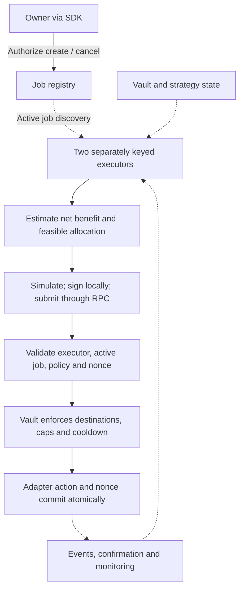

# Stellar architecture

Earn is Ditto's USDC vault on Stellar and the first application of its reusable operator connector, job registry and public TypeScript SDK. This document defines the funded implementation. The existing [native-XLM proof](../prototype/README.md) only demonstrates token custody and authorization.

## Components and custody

| Component | Responsibility | Assets / authority |
| --- | --- | --- |
| User Stellar wallet | Signs deposits and redemptions | USDC and Earn shares |
| Earn vault | Shares, NAV, buffer, permitted allocation | Idle USDC and ownership of strategy positions |
| Blend adapter / USDC pool | Supply, withdraw, reserve valuation | Vault-owned indexed lending position |
| Sentora USDC / Upshift adapter | Deposit, receipt valuation and redeem | Vault-owned strategy shares; underlying backing is managed by Sentora |
| Job registry | Owner, vault, active status, policy version and nonce | No user assets |
| Ditto operators | Read, calculate, simulate, sign and submit | Execution keys only; no user asset custody |
| CCTP / CctpForwarder | Burn-and-mint settlement | Destination USDC forwarded to the user's Stellar account |
| NEAR Intents 1Click | Quote, source deposit, settlement or refund | External settlement path; separate from the vault |

Circle-issued Stellar USDC is the deposit and redemption asset. Direct Earn positions and receipt ownership are on Stellar. Managed strategy backing can sit outside Stellar and is not independently verified merely by reading a receipt balance.

```mermaid
sequenceDiagram
    actor U as User
    participant F as CCTP or Intents route
    participant W as User Stellar wallet
    participant V as Earn vault
    participant P as Blend or Sentora adapter
    opt Fund from supported external chain
        U->>F: Authorize source transfer
        F->>W: Settle Stellar USDC
    end
    U->>V: Authorize deposit, with minimum shares
    W->>V: Transfer USDC under user authorization
    V->>U: Record proportional Earn shares
    Note over V,P: Operator action must pass registry and vault policy checks
    V->>P: Allocate USDC; record vault-owned position
    U->>V: Authorize redemption, with minimum assets
    V->>P: Recall available liquidity if needed
    P->>V: Return USDC
    V->>W: Pay USDC and burn shares atomically
    Note over U,P: Failed exit reverts and preserves shares
```

## Accounting and allocation

NAV is idle USDC plus indexed Blend value plus underlying-reported USDC value of Sentora shares. Share conversions normalize token decimals and round conservatively. Tests cover first-deposit/donation attacks, fees, empty vaults, losses, partial liquidity and failed redemptions. Unrealized receipt value must not be confused with instantly withdrawable liquidity.

Operators compare estimated net returns over a configured horizon after fees and movement costs. Blend uses reserve-based estimates; Sentora uses conservative historical return estimates. Rebalance only when the expected benefit exceeds the configured threshold. Onchain contracts enforce the destinations, caps, cooldown and nonce. They do not prove the accuracy of an offchain yield forecast.

The launch deposit cap is 100,000 USDC. The idle target is 10%. New or increased Sentora exposure is capped at 20% of NAV; passive value movements can change the weight. Earn does not borrow or leverage. Use idle assets first for redemption, then recall available strategy liquidity. A redemption that cannot deliver its required amount reverts atomically, leaving shares intact. The UI shows currently redeemable USDC. A buffer target is not an immediate-exit guarantee.

## Named strategy interfaces

**Blend:** supply/withdraw USDC through the pool's authorized submit interface, read indexed position value and reserve liquidity. The reviewed pool/version and asset contract are pinned in the deployment manifest. Multiple Blend pools are markets within one protocol, not independent venues.

**Sentora USDC on Upshift:** use the Stellar vault interface for deposits, share conversion, max-withdraw/max-redeem reads and redemption. Earn owns the underlying receipt shares and authorizes adapter calls with the required Soroban contract invocation context. Underlying NAV includes managed assets; withdrawals are limited by available liquidity and can wait on the manager returning funds. No fixed withdrawal-time guarantee is assumed. Repeatable milestone-2 tests use a local interface fixture plus read-only checks of the live contract; milestone 3 includes live deposit and redemption verification.

## Funding routes

**Base and Ethereum via Circle CCTP.** Preflight the Stellar account and USDC trustline before source burn. Use the official network-specific CctpForwarder as both `mintRecipient` and `destinationCaller`, with the user's Stellar recipient in hook data. Submit the attested message through `mint_and_forward`. Normalize six-decimal source amounts and seven-decimal Stellar USDC. A separate user-authorized vault deposit follows settlement. Track source burn, attestation, forwarding and vault deposit independently so a resumed session does not deposit twice.

**Solana USDC via NEAR Intents 1Click.** Obtain a quote for the exact source and destination USDC identifiers; validate recipient, refund address, expiry and slippage. The user sends to the quoted deposit address. Track settlement or refund before offering the separately authorized vault deposit. Milestone-2 evidence is live dry quotes and deterministic settlement/refund fixtures, followed by live mainnet route verification in milestone 3.

Freighter and xBull are wallet-connection integrations through Stellar Wallets Kit, not promised in-wallet listings. Supported routes are explicit; no every-chain compatibility is claimed.

## Automation and permissions



The registry stores the vault, job owner, active flag, policy version, nonce and permitted executors. SDK methods support job creation, cancellation and status. The first valid execution wins; duplicate nonce attempts revert. Confirmed cancellation blocks later execution and does not reverse finalized transactions. Retry against current state after unknown transaction outcomes.

User signatures control deposits and redemptions. Executors only run supported allocation jobs. A 2-of-3 admin multisig controls executor enrollment and emergency deposit/allocation pause. Launch strategy addresses and upper limits are fixed. New strategy code requires a reviewed release and opt-in migration. Ditto's pause leaves exits callable against available liquidity, while underlying strategy pauses and issuer controls can still limit exits.

Two executor instances demonstrate failover, not independent organizations, a new consensus protocol or inherited EVM slashing security. This release does not offer arbitrary user-code execution.

## Release and verification

$96,000 covers 1,200 team-hours across 16 weeks. MVP in weeks 1-5; operators, second adapter and routes in weeks 6-10; external review, remediation, capped mainnet and 14-day observation in weeks 11-16. Reserve independent review in weeks 1-2, freeze security-critical scope by week 8 and submit the full candidate by week 10. Deposits open only after review and critical/high remediation. External audit fees are separate from the development request.

See the [costed roadmap](roadmap.md), [security design](security.md), [test plan](test-plan.md) and [deployment manifest requirements](deployments.md). Future Stellar lending, RWA and Spark access extensions require separate adapter, custody, eligibility and liquidity work.

References: [Circle Stellar](https://developers.circle.com/cctp/references/stellar), [Blend](https://docs.blend.capital/), [Upshift Stellar interface](https://docs.upshift.finance/vault-architecture/stellar), [NEAR Intents 1Click](https://docs.near-intents.org/integration/distribution-channels/1click-api/quickstart/making-a-request).
