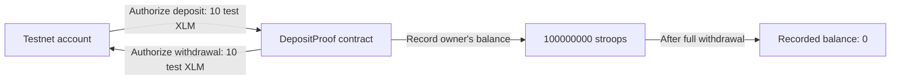

# Minimal Soroban deposit/withdraw proof

**A real testnet round trip, built before the grant.** This is a generic SEP-41 custody and authorization demonstration. It is not the Earn yield vault.

On 27 October 2026 the contract accepted **10 native testnet XLM** (100,000,000 stroops) and returned all 10 to the same authorized account. Testnet tokens have no monetary value. This does **not** demonstrate Circle USDC or a lending integration.

| Item | Evidence |
| --- | --- |
| Contract | `CDIFRFUBAAXTPHMRZHVLCQ3HRQMODAEKWA4MV3DRSKRWC7MQQKJTSNGQ` |
| Account | `GDRZTMYY4A7Z4GWJJ2AZ6XCUYUXHWUACHRLKWA3PX7CMSYL2TI6WMZBE` |
| Deposit | [Successful transaction](https://stellar.expert/explorer/testnet/tx/28b8f1956c102c01146597d2c556089fea6fd385e01ad9ab6eca5d2d19173fe0) |
| Withdrawal | [Successful transaction](https://stellar.expert/explorer/testnet/tx/0140d82cecec4eb7f0689a18fe454d5a6337a1dd24d58f1a43a01d442445c6a5) |
| Final recorded deposit balance | 0 |
| Source | [Contract](src/lib.rs) and [six unit tests](src/test.rs) |
| Reproducible evidence | [Manifest](../docs/evidence/testnet-proof-2026-10-27.json), [test output](../docs/evidence/testnet-tests-2026-10-27.txt) and archived public transaction records |

## Contract behavior

The constructor fixes one token contract. `deposit(owner, amount)` requires owner authorization and transfers tokens into the contract. `withdraw(owner, amount)` requires the same owner's authorization and returns tokens only to that owner. Each balance update and token transfer commits atomically. Non-positive amounts and withdrawals exceeding the recorded deposit are rejected. Instance and owner-balance TTLs are extended on successful mutations; long-term archival and restoration are not a finished product feature.



## Reproduce locally

Rust 1.96.0, Soroban SDK 29.0.1 and Stellar CLI 28.1.0 were used. From the repository root:

```sh
rustup target add wasm32v1-none
cargo test --locked
stellar contract build
```

Six tests cover a full round trip, isolated owner balances, invalid amounts, excessive withdrawal, failed token transfer and missing authorization. Tests are evidence of these cases, not a security audit.

To run a new network demo, use a new testnet-only identity and never reuse a mainnet key:

```sh
stellar keys generate ditto-proof-demo --network testnet --fund
stellar contract deploy --wasm target/wasm32v1-none/release/ditto_vault_proof.wasm   --source-account ditto-proof-demo --network testnet --alias ditto-proof-demo   -- --asset CDLZFC3SYJYDZT7K67VZ75HPJVIEUVNIXF47ZG2FB2RMQQVU2HHGCYSC
# Replace YOUR_PUBLIC_ADDRESS with: stellar keys address ditto-proof-demo
stellar contract invoke --id ditto-proof-demo --source-account ditto-proof-demo   --network testnet --send=yes -- deposit --owner YOUR_PUBLIC_ADDRESS --amount 100000000
stellar contract invoke --id ditto-proof-demo --source-account ditto-proof-demo   --network testnet --send=yes -- withdraw --owner YOUR_PUBLIC_ADDRESS --amount 100000000
```

Testnet resets and storage expiry can make old explorer/RPC links unavailable. Archived transaction records preserve the observed results; the source can be redeployed.

## Scope and funding

This pre-award proof is self-funded and excluded from the $120,000 request. Funded work still includes the production vault's USDC integration, proportional yield shares, pool valuation, rounding/donation defenses, strategy adapter, registry, operators, SDK, CCTP, UI and reviewed mainnet release.

No yield, transferable shares, pool adapter, automation, bridge or mainnet deployment is implemented here. No independent audit or named-engineer code review is claimed. Do not use this prototype with real assets.

AI assisted the source, tests and documentation. Vlad and Efim must review any code selected for the funded implementation; the prototype is not automatically production code. Apache-2.0 applies to this source.
